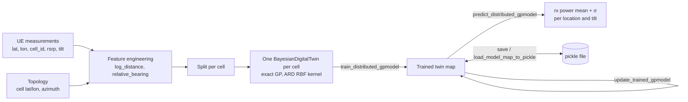

# Bayesian Digital Twin (BDT)

> **Version:** 1.0 | **Date:** October 18, 2026

## Table of Contents

1. **[Overview](#1-overview)**
2. **[What the BDT Does](#2-what-the-bdt-does)**
3. **[Architecture & Components](#3-architecture--components)**
4. **[Directory Structure](#4-directory-structure)**
5. **[Prerequisites and Setup](#5-prerequisites-and-setup)**
6. **[Quick Start Example](#6-quick-start-example)**
7. **[Step-by-Step Usage Guide](#7-step-by-step-usage-guide)**
8. **[Model Behaviour: What to Expect](#8-model-behaviour-what-to-expect)**
9. **[Related Notebooks](#9-related-notebooks)**
10. **[Testing](#10-testing)**
11. **[Troubleshooting](#11-troubleshooting)**

---
> **Prerequisites:** Complete the setup steps in [DEVELOPER-GUIDE.md](DEVELOPER-GUIDE.md) before proceeding.

# **1. Overview**

The **Bayesian Digital Twin (BDT)** is RADP's RF digital twin. It learns how strongly each cell is received at any location, under any antenna tilt, from measured or simulated data. It then answers what-if questions such as *"what would coverage look like if cell 3 were tilted to 12°?"* without touching the live network.

Every prediction comes with its own uncertainty (σ), and new measurements can be folded in within a fraction of a second, without retraining. The BDT is the RF engine behind the RADP Train and Simulation APIs and behind the CCO, MRO, Energy Savings and Load Balancing applications.

---

# **2. What the BDT Does**

**Core Function:** Predicts per-cell received power (dBm) at arbitrary locations and tilt settings, with a predictive standard deviation, from a sample of measurements.

**Key Logic:**

- **Problem:** Optimisers need to evaluate thousands of candidate configurations, and the real network cannot be reconfigured that often.
- **Solution:** One **exact Gaussian process (GP)** per cell, trained on that cell's measurements. A GP interpolates smoothly between observations and reports how sure it is.
- **Process:** Engineer features relative to each cell → train one GP per cell → predict mean ± σ for any (location, tilt) → fold in new data with a fantasy update → save the `{cell_id: twin}` map.

**The model in one table:**

| Aspect | Detail |
|---|---|
| **Unit** | One `BayesianDigitalTwin` per cell, stored as a `{cell_id: twin}` map |
| **Inputs (default)** | `log_distance` (log of metres from the site), `relative_bearing` (degrees from antenna boresight, 0–360), `cell_el_deg` (electrical tilt) |
| **Target** | Received power: `avg_rsrp` in the RADP service, `cell_rxpwr_dbm` in the simulator data |
| **Kernel** | Scaled RBF with **ARD**, one lengthscale per input (`ard=True`, the default) |
| **Normalisation** | Min-max on inputs (`NormMethod.MINMAX`, the default), z-score on the target |
| **Training** | Adam on the exact marginal log-likelihood (`maxiter=100`, `lr=0.05`, `stopping_threshold=1e-4`) |
| **Prediction** | Posterior mean and std in dBm, including the learned noise |
| **Update** | GP fantasy update: conditions on new rows with the hyperparameters held fixed |

The model never sees latitude and longitude directly. Describing each row relative to its cell lets one twin generalise across the whole footprint, and makes tilt a smooth third dimension it can interpolate along.

---

# **3. Architecture & Components**

## System Pipeline



## Core Class: `BayesianDigitalTwin`

Defined in [bayesian_engine.py](radp/digital_twin/rf/bayesian/bayesian_engine.py).

| Method | What it does |
|---|---|
| `BayesianDigitalTwin(data_in, x_columns, y_columns, norm_method=NormMethod.MINMAX, x_max=None, x_min=None, ard=True, prior_mean="constant", antenna_height_diff_m=18.0)` | Builds the GP for the cell DataFrame(s) in `data_in` and computes normalisation statistics. `x_min`/`x_max` override the observed ranges per column. `prior_mean="antenna"` swaps the constant prior mean for path loss plus the 3GPP antenna patterns (see [Section 8](#where-the-twin-is-biased)). Does **not** train. |
| `preprocess_ue_training_data(ue_training_data_df, topology_df)` *(static)* | Adds the cell's location, azimuth and frequency, plus `log_distance` and `relative_bearing`, to every UE row. Returns `{cell_id: DataFrame}`. |
| `preprocess_ue_prediction_data(ue_data_df, config_df, topology_df)` *(static)* | Same for prediction. Tilt comes from `config_df`. `ue_data_df` needs one row per (location, cell). |
| `create_prediction_frames(site_config_df, prediction_frame_template)` *(static)* | Builds per-cell prediction frames for a grid of `loc_x`/`loc_y` points. |
| `train_distributed_gpmodel(maxiter=100, lr=0.05, stopping_threshold=1e-4)` | Fits the hyperparameters. Returns the loss per iteration, zero-padded after an early stop. |
| `predict_distributed_gpmodel(prediction_dfs)` | Returns `(mean, std)` arrays of shape `[num_cells, n]` in dBm. Also writes `rxpower_dbm` and `rxpower_stddev_dbm` into the frames you pass in. Logs one warning per twin when many rows are far from the training data. |
| `support_ratio(pred_stds)` / `prior_stddev_dbm()` | How little each prediction is informed by the training data: about 0 among training rows, about 1 far from all of them, or everywhere for a twin that learned little (e.g. a handful of rows). Rows above `OUT_OF_SUPPORT_RATIO` (0.25) are out of support, and their means fall back toward the training mean. |
| `update_trained_gpmodel(data_in)` | Fantasy update with new rows. Rebuilds exact posterior caches first, so it is stable above 800 rows and needs no prior prediction. |
| `save_model_map_to_pickle(path, model_map)` / `load_model_map_from_pickle(path)` *(static)* | Persists the `{cell_id: twin}` map. GPyTorch's posterior caches are left out of the file and rebuilt on demand; in-memory twins keep theirs. |

## Who Uses the BDT

- **[services/training/training_driver.py](services/training/training_driver.py)** is the worker behind the RADP **Train API**. It trains, or with `model_update=True` updates, one twin per cell on `cell_el_deg`, `log_distance` and `relative_bearing` → `avg_rsrp`, using fixed `x_min`/`x_max` ranges.
- **[services/rf_prediction/rf_prediction_driver.py](services/rf_prediction/rf_prediction_driver.py)** is the RF prediction stage of the **Simulation API**. It loads a model map and adds `rxpower_dbm` to UE tracks.
- **[apps/mobility_robustness_optimization](apps/mobility_robustness_optimization)** trains and updates twins from UE data, then predicts received power along UE tracks (see [README-MRO.md](README-MRO.md)).
- **[apps/energy_savings](apps/energy_savings)** and **[apps/load_balancing](apps/load_balancing)** load a trained model map as the RF model inside their RL environments.
- **[apps/coverage_capacity_optimization](apps/coverage_capacity_optimization)** reaches the BDT through the RADP Train and Simulation APIs (see [README-CCO.md](README-CCO.md)).

---

# **4. Directory Structure**

```text
radp/digital_twin/rf/bayesian/
├── __init__.py
├── bayesian_engine.py              # BayesianDigitalTwin, ExactGPModel, NormMethod
└── tests/
    └── test_bayesian_engine.py     # training, bearing convention, ARD, fantasy update, save/load

radp/digital_twin/utils/gis_tools.py              # log-distance and relative-bearing helpers (scalar + vectorised)
radp/example_bayesian_engine_driver_script.py     # minimal in-memory train/predict script
services/training/training_driver.py              # RADP Train API worker
services/rf_prediction/rf_prediction_driver.py    # RADP RF prediction worker
notebooks/bdt_from_scratch.ipynb                  # end-to-end walkthrough with KPIs and visuals
notebooks/data/sim_data.zip                       # 5-run tilt sweep (4°-16°), 5 cells
```

---

# **5. Prerequisites and Setup**

For the Python environment, Docker services and dependencies, see [DEVELOPER-GUIDE.md](DEVELOPER-GUIDE.md). Running the notebooks is covered in [README-NOTEBOOKS.md](README-NOTEBOOKS.md).

## Quick Setup Summary

**System Requirements:**

- Python 3.9.x to 3.10.x
- `torch` and `gpytorch`. `notebooks/requirements.txt` pins torch 2.0 and gpytorch 1.9.1; the walkthrough notebook was run with torch 2.8 and gpytorch 1.11.
- CPU is enough. A CUDA GPU is used automatically when `torch.cuda.is_available()`.
- Run from the repository root, or put it on `PYTHONPATH`:

```bash
export PYTHONPATH="$(pwd)":$PYTHONPATH
```

---

# **6. Quick Start Example**

Train a twin for one cell on four tilts of the bundled tilt sweep, then predict the fifth tilt, which it has never seen. No unzip step and no running services are needed.

```python
import zipfile

import pandas as pd

from radp.digital_twin.rf.bayesian.bayesian_engine import BayesianDigitalTwin
from radp.digital_twin.utils.gis_tools import GISTools

with zipfile.ZipFile("notebooks/data/sim_data.zip") as z:
    site = pd.read_csv(z.open("sim_data/3cell/sim_001/site_config.csv"))
    runs = [pd.read_csv(z.open(f"sim_data/3cell/sim_00{i}/full_data.csv")) for i in range(1, 6)]

cell = site.iloc[0]  # cell 1


def cell_rows(run):
    """One cell's rows from a simulator run, with the BDT's engineered features."""
    rows = run[run.cell_id == cell.cell_id].copy()
    lat, lon = rows.loc_y.values, rows.loc_x.values
    rows["log_distance"] = GISTools.get_log_distance_vec(cell.cell_lat, cell.cell_lon, lat, lon)
    rows["relative_bearing"] = GISTools.get_relative_bearing_vec(cell.cell_az_deg, cell.cell_lat, cell.cell_lon, lat, lon)
    return rows


# train on 20% of the 4°, 7°, 13° and 16° runs; test on the 10° run the twin never sees
train = pd.concat([cell_rows(runs[i]).sample(frac=0.2, random_state=0) for i in (0, 1, 3, 4)])
test = cell_rows(runs[2])

twin = BayesianDigitalTwin(
    data_in=[train],
    x_columns=["log_distance", "relative_bearing", "cell_el_deg"],
    y_columns=["cell_rxpwr_dbm"],
)
twin.train_distributed_gpmodel(maxiter=100)

mean, std = twin.predict_distributed_gpmodel([test.copy()])
print(f"MAE on the unseen tilt: {abs(mean[0] - test.cell_rxpwr_dbm).mean():.2f} dB, mean σ {std[0].mean():.2f} dB")
```

**Expected Output** (about 5 s on a laptop CPU):

```text
MAE on the unseen tilt: 0.77 dB, mean σ 1.20 dB
```

For the full network, with maps, calibration and network KPIs, run [notebooks/bdt_from_scratch.ipynb](notebooks/bdt_from_scratch.ipynb).

---

# **7. Step-by-Step Usage Guide**

This section uses the CSV formats of the RADP Train API (see [README.md](README.md#ue-training-data-file)) and the sample files in [apps/example/data](apps/example/data).

## Step 1: Prepare Input Data

**ue_training_data.csv**: one row per (location, cell) measurement:

```csv
cell_id,avg_rsrp,lon,lat,cell_el_deg
cell_1,-80,139.699058,35.644327,0
```

**topology.csv**: one row per cell:

```csv
cell_lat,cell_lon,cell_id,cell_az_deg,cell_carrier_freq_mhz
35.690556,139.691944,cell_1,0,2100
```

Engineer the features and split per cell:

```python
import pandas as pd

from radp.digital_twin.rf.bayesian.bayesian_engine import BayesianDigitalTwin

ue_training_data = pd.read_csv("apps/example/data/ue_training_data.csv")
topology = pd.read_csv("apps/example/data/topology.csv")

per_cell_training = BayesianDigitalTwin.preprocess_ue_training_data(ue_training_data, topology)  # {cell_id: DataFrame}
```

---

## Step 2: Train One Twin per Cell

```python
X_COLUMNS = ["cell_el_deg", "log_distance", "relative_bearing"]
X_MIN = {"cell_el_deg": -10, "log_distance": 0, "relative_bearing": 0}  # fixed ranges, as the
X_MAX = {"cell_el_deg": 50, "log_distance": 5, "relative_bearing": 360}  # training service uses

twins = {}
for cell_id, rows in per_cell_training.items():
    twins[cell_id] = BayesianDigitalTwin([rows], X_COLUMNS, ["avg_rsrp"], x_min=X_MIN, x_max=X_MAX)
    twins[cell_id].train_distributed_gpmodel(maxiter=100, lr=0.05, stopping_threshold=1e-4)
```

Pass `x_min`/`x_max` whenever a feature can be constant within a cell's training data, for example when only one tilt was measured. Without them min-max normalisation divides by zero (see [Troubleshooting](#11-troubleshooting)).

---

## Step 3: Predict Under a Cell Configuration

```python
ue_locations = pd.read_csv("apps/example/data/ue_data_geo_only.csv")  # lon, lat
config = pd.read_csv("apps/example/data/config.csv")  # cell_id, cell_el_deg  <- the configuration to evaluate
ue_data = ue_locations.merge(config[["cell_id"]], how="cross")  # one row per (location, cell)

per_cell_prediction = BayesianDigitalTwin.preprocess_ue_prediction_data(ue_data, config, topology)
for cell_id, rows in per_cell_prediction.items():
    mean, std = twins[cell_id].predict_distributed_gpmodel([rows])  # also adds rxpower_dbm / rxpower_stddev_dbm to rows
```

With the 5 sample rows per cell, expect one "barely informed by the training data" warning per cell here. Five rows are too few to learn from: each twin puts them down to noise and predicts close to its training mean everywhere (see [Section 8](#where-the-twin-is-biased)).

To evaluate a different tilt, change `cell_el_deg` in `config` and predict again; no retraining is needed. Network RSRP at a location is the maximum of the per-cell predictions there, and the best server is the cell that achieves it.

---

## Step 4: Fold In New Measurements

```python
new_data = BayesianDigitalTwin.preprocess_ue_training_data(pd.read_csv("apps/example/data/ue_training_data_2.csv"), topology)
for cell_id, rows in new_data.items():
    twins[cell_id].update_trained_gpmodel([rows])
```

The update keeps the hyperparameters fixed and takes a fraction of a second. Cells that have no twin yet must be trained first, as in Step 2.

---

## Step 5: Save and Load

```python
BayesianDigitalTwin.save_model_map_to_pickle("bdt_model_map.pickle", twins)
twins = BayesianDigitalTwin.load_model_map_from_pickle("bdt_model_map.pickle")
```

Always save through `save_model_map_to_pickle`. A plain `pickle.dump` of a twin that has predicted or been updated also writes GPyTorch's posterior caches: tens of MB per cell instead of kilobytes.

---

## Through the RADP Service

With the RADP services running, the same steps go through the client. Training parameters are passed straight to `train_distributed_gpmodel`.

```python
from radp.client.client import RADPClient
from radp.client.helper import RADPHelper

radp_client = RADPClient()
radp_helper = RADPHelper(radp_client)

response = radp_client.train(
    model_id="my_bdt",
    params={"maxiter": 100, "lr": 0.05, "stopping_threshold": 1e-4},
    ue_training_data="ue_training_data.csv",
    topology="topology.csv",
    model_update=False,  # True: fantasy-update the existing twins of my_bdt, train new cells from scratch
)
radp_helper.resolve_model_status(model_id=response["model_id"], job_id=response["job_id"], verbose=True)
```

RF prediction then runs as a stage of the Simulation API with `"rf_prediction": {"model_id": "my_bdt"}`. See [README.md](README.md#train-api) for the full API and [apps/example/example_app.py](apps/example/example_app.py) for an incremental-update example.

---

# **8. Model Behaviour: What to Expect**

Measured in [notebooks/bdt_from_scratch.ipynb](notebooks/bdt_from_scratch.ipynb) on the bundled tilt sweep. The setup: 5 cells, trained on a 20% sample of the 4°, 7°, 13° and 16° runs (about 2,500 rows per cell) and tested on every row of the unseen 10° run. It ran on a laptop CPU with gpytorch 1.11. Expect different numbers on your own data; the patterns are what carry over.

| KPI | Value |
|---|---|
| MAE / RMSE / P95 \|error\| (per-cell rows) | 0.88 / 1.37 / 2.13 dB |
| R² | 0.988 |
| Network RSRP MAE (strongest cell per location) | 0.94 dB |
| Coverage ≥ -105 dBm, twin vs truth | 45.7% vs 48.1% |
| Best-server agreement (locations reached by ≥2 cells) | 98.3% |
| Truth inside ±1σ / ±2σ (nominal 68% / 95%) | 76% / 98% |
| Training time | about 5 s per cell, 100 iterations |
| Inference | about 47 ms per 1,000 rows |
| Fantasy update vs full retrain (400 new rows) | 0.15 s vs 6.1 s, same accuracy |
| Saved model map, 5 cells | 0.25 MB |

**Guidance that follows from those runs:**

- **Interpolate, don't extrapolate.** Predicting a tilt *between* measured tilts costs about 1 dB or less. Predicting 16° from 4–13° data more than doubled the error, and only about 60% of the true values fell inside ±2σ. If a configuration lies outside what you measured, collect some data there: 400 new measurements and a fantasy update brought the 16° error from 2.3 dB to 0.7 dB.
- **Keep `maxiter` near the default.** The loss is still falling at 100 iterations, but training longer did not improve MAE. It drove the learned noise toward zero, made the loss spike, and could collapse ±2σ coverage (99% → 58% for one cell). The default works as a regulariser for σ.
- **Sample size saturates early.** About 600–1,200 rows per cell (5–10% of a run) matched the accuracy of 2,500. Above about 600 rows, training time roughly quadruples each time the rows double.
- **The learned lengthscales are interpretable.** In physical units the model decorrelates over about 30° of bearing (the antenna lobe), ×2.7–5.5 in distance, and 7–17° of tilt. Tilt being the smoothest input is what lets the twin interpolate between configurations.
- **Expect the largest errors near the masts.** Within about 100 m of a site, errors spread to ±10 dB; elsewhere the middle 50% of errors stay within about ±1.5 dB.
- **Treat σ as a risk ranking, not a guarantee.** It flags the masts well but under-covers systematic interpolation error. σ from the default fast-variance path also varies by up to about 1.4 dB between two cache rebuilds of the same model. It runs wider than the exact posterior σ: about 1.1× in this setup, and up to 2× with 1,200 rows per cell.
- **Update continuously, retrain on a schedule.** Fantasy updates freeze the hyperparameters; retraining re-learns them. On the tilt sweep, retraining added no accuracy at about 40× the cost.

## Where the Twin Is Biased

A prediction at a point the twin never saw is **not** biased by itself. Bias comes from where that point sits relative to the training data, and from how the training data was chosen. Signed bias is the mean of prediction minus truth.

**Setup:** the bundled tilt sweep, 5 cells, 1,200 training rows per cell, seed 0. Each test set holds out what its row describes. The 10° row also reproduces in the §8 setup above (−0.48 dB).

| Prediction point | Bias, default twin | With `prior_mean="antenna"` |
|---|---|---|
| Unseen location inside the measured footprint | −0.03 dB | 0.00 dB |
| Unseen tilt between measured tilts (10°) | −0.40 dB, all cells low | 0.00 dB |
| Tilt beyond the measured range (16° from 4–13°) | −1.71 dB | +0.27 dB |
| Beyond the measured distance (trained ≤ 400 m, tested 400–800 m) | **+2.85 dB** | +0.85 dB |
| Near the mast, with no training rows within 150 m | +1.75 dB | +1.45 dB |
| Behind the antenna, with no training rows at 120–240° | −3.3 to +8.3 dB per cell (unreliable) | −2.5 to +7.6 dB per cell |
| Training data with every reading below −110 dBm dropped | **+5.65 dB**, +8.9 dB where truth < −110 dBm | +1.65 dB |

What drives it:

- **Far from all training data, the default twin falls back to the training-mean RSRP.** Trained on a full 0–800 m disc, it predicts −112.6 dBm at 5 km along boresight. That is the training mean; a log-distance fit to the same data gives −125.4 dBm. Its σ grows to about 16 dB there, so `support_ratio` catches it (AUROC 0.90 for errors above 3 dB on these runs). No caller reads σ by default.
- **Training data selected on RSRP biases the twin upward.** That covers dropping weak or undetected readings, keeping only the strongest samples, and some measurement-report setups. Filling non-detections in *at* the floor value makes it worse (+8.3 dB), because the floor is an upper bound on the true value. MRO's fantasy update used to keep the 500 strongest samples. With 4 dB of measurement noise that biased the updated twin by +1.1 dB, against +0.1 dB for a random 500, so it now takes a random 500.
- **`prior_mean="antenna"` shrinks the extrapolation bias,** but it has only been checked on simulated data. The simulator likely uses the same 3GPP-style pattern, so expect a smaller gain on measured data. It also tightened ±2σ near the mast too far (94% → 75%).

Flag the predictions to treat with care:

```python
mean, std = twin.predict_distributed_gpmodel([frame])
far = twin.support_ratio(std) > BayesianDigitalTwin.OUT_OF_SUPPORT_RATIO  # boolean, shape [num_cells, n]
```

---

# **9. Related Notebooks**

### [notebooks/bdt_from_scratch.ipynb](notebooks/bdt_from_scratch.ipynb)

**Purpose:** End-to-end BDT walkthrough with KPIs and visuals. It reads `sim_data.zip` directly and needs no `radp_library`, plotly or ffmpeg. It runs in 3–5 minutes on a CPU.

**Contents:**

- Topology, per-cell footprints, and RSRP across the tilt sweep
- Feature engineering: the path-loss curve and the antenna pattern
- Training loss and "watch it learn" prediction and error maps
- ARD lengthscales in physical units
- Held-out accuracy, error and σ maps, calibration
- Training budget vs calibration
- Tilt what-if sweeps and network coverage and best-server per tilt
- Leave-one-tilt-out, learning curve, fantasy update vs retrain
- Pickle round-trip and a final scorecard

**When to Use:** Learning how the BDT works, judging whether it fits your use case, or as a template for evaluating a twin on your own data.

---

### [notebooks/coo_with_radp_digital_twin.ipynb](notebooks/coo_with_radp_digital_twin.ipynb)

**Purpose:** Trains BDTs through `radp_library.bdt()` across training-set sizes and iteration counts, and animates the predictions. It needs the full `notebooks/requirements.txt` environment and ffmpeg.

---

### [notebooks/mro.ipynb](notebooks/mro.ipynb)

**Purpose:** The BDT inside the MRO workflow: training twins on UE data and predicting received power along UE tracks.

---

# **10. Testing**

```bash
python3 -m pytest radp/digital_twin/rf/bayesian/tests -q
```

The suite covers:

- training and reproducibility on sample data
- train/predict bearing-convention agreement
- the ARD kernel
- fantasy updates against an independent exact posterior: single, chained, without a prior predict, and after a save and reload
- save/load: file size after predict and after update, in-memory caches surviving a save, and identical predictions after reload
- `support_ratio`: near 0 among training rows (also for a noisy twin), near 1 far from them, and one warning per twin
- `prior_mean="antenna"`: extrapolation beyond the trained distance, buffers that follow the model across devices, update and reload, and twins without a tilt column

---

# **11. Troubleshooting**

#### Issue 1: `RuntimeError: You must train on the training inputs!`

**Cause:** A feature is constant in a cell's training data, typically `cell_el_deg` when only one tilt was measured. Min-max normalisation then computes 0/0 and the training tensor contains NaN.

**Solution:** Pass explicit ranges:

```python
BayesianDigitalTwin([rows], X_COLUMNS, ["avg_rsrp"], x_min={"cell_el_deg": -10}, x_max={"cell_el_deg": 50})
```

---

#### Issue 2: One log line per training iteration

**Cause:** The `radp.digital_twin` logger is set to INFO when the package is imported.

**Solution:** Lower it *after* importing the engine:

```python
import logging
logging.getLogger("radp.digital_twin").setLevel(logging.WARNING)
```

---

#### Issue 3: Input DataFrame changed, or `SettingWithCopyWarning`

**Cause:** `predict_distributed_gpmodel` writes `rxpower_dbm` and `rxpower_stddev_dbm` into the frames you pass in.

**Solution:** Pass `rows.copy()` if you need the original frame unchanged, or if it is a slice of a larger DataFrame.

---

#### Issue 4: Model files of tens or hundreds of MB

**Cause:** The file was saved with `pickle.dump`, or before posterior caches were excluded from `save_model_map_to_pickle`.

**Solution:** Load it and save it again with `BayesianDigitalTwin.save_model_map_to_pickle`.

---

#### Issue 5: `NotPSDError` or a wrong posterior after `update_trained_gpmodel`

**Cause:** Older versions of the engine reused GPyTorch's float32 Lanczos caches for the fantasy update. Above 800 training rows that produced an indefinite or wrong posterior.

**Solution:** Use the current engine. It rebuilds exact caches before every update and needs no prior prediction.

---

#### Issue 6: `CG terminated in 1000 iterations ...` warnings, or a spiking loss

**Cause:** Training far beyond the default `maxiter`. The learned noise collapses and the linear solves become ill-conditioned.

**Solution:** Keep `maxiter` near 100 (see [Section 8](#8-model-behaviour-what-to-expect)).

---

#### Issue 7: Preprocessing is slow on large datasets

**Cause:** `preprocess_ue_training_data` and `preprocess_ue_prediction_data` loop over rows one at a time.

**Solution:** For large tables, compute the features with the vectorised helpers `GISTools.get_log_distance_vec` and `GISTools.get_relative_bearing_vec`, as in the [Quick Start](#6-quick-start-example). They use the same bearing convention as the engine's prediction path.

---

**For questions or contributions, please refer to the main project documentation.**
