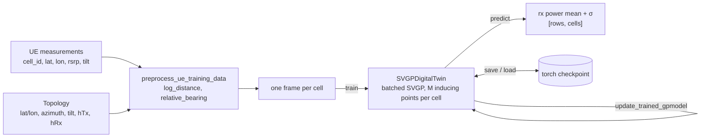

# SVGP Digital Twin

> **Version:** 1.0 | **Date:** October 18, 2026

## Table of Contents

1. **[Overview](#1-overview)**
2. **[What the SVGP Twin Does](#2-what-the-svgp-twin-does)**
3. **[Architecture & Components](#3-architecture--components)**
4. **[Directory Structure](#4-directory-structure)**
5. **[Prerequisites and Setup](#5-prerequisites-and-setup)**
6. **[Quick Start Example](#6-quick-start-example)**
7. **[Step-by-Step Usage Guide](#7-step-by-step-usage-guide)**
8. **[Model Behaviour: What to Expect](#8-model-behaviour-what-to-expect)**
9. **[SVGP or BDT?](#9-svgp-or-bdt)**
10. **[Related Notebooks](#10-related-notebooks)**
11. **[Testing](#11-testing)**
12. **[Troubleshooting](#12-troubleshooting)**

---
> **Prerequisites:** Complete the setup steps in [DEVELOPER-GUIDE.md](DEVELOPER-GUIDE.md) before proceeding.

# **1. Overview**

The **SVGP digital twin** (`SVGPDigitalTwin`) is RADP's second RF digital twin, next to the exact-GP [Bayesian Digital Twin](README-BDT.md). It learns the same thing: how strongly each cell is received at any location, under any antenna tilt, with an uncertainty (σ) on every prediction.

The difference is how it scales. The BDT is an exact Gaussian process (GP), and its training cost grows roughly with the cube of the rows per cell. The SVGP is a **sparse variational GP**: each cell is summarised by a few hundred learned *inducing points* and trained on mini-batches. The cost of a training step depends on the batch size and the number of inducing points, not on the number of rows.

**Status.** The engine, its tests and a walkthrough notebook exist. No RADP service or application uses it yet: the Train and Simulation APIs and the CCO, MRO, Energy Savings and Load Balancing apps all run the BDT.

---

# **2. What the SVGP Twin Does**

**Core Function:** Predicts per-cell received power (dBm) at arbitrary locations and tilt settings, with a predictive standard deviation, from a sample of measurements, and keeps doing so when a cell has far more measurements than an exact GP can afford.

**Key Logic:**

- **Problem:** An exact GP per cell gets slow quickly. On the bundled data, 10,000 rows for one cell already take the BDT about 1–2 minutes to train.
- **Solution:** A sparse variational GP. M inducing points per cell, a variational lower bound (the ELBO) optimised on mini-batches, and all cells trained together in one batched model.
- **Process:** Engineer features relative to each cell → train every cell in one call → predict mean ± σ for any (location, tilt) → adapt with a short streaming update → save one checkpoint.

**The model in one table:**

| Aspect | Detail |
|---|---|
| **Unit** | One `SVGPDigitalTwin` holds every cell. By default the cells are independent GPs trained together in one batched model |
| **Inputs** | Any numeric columns. The walkthrough uses `log_distance`, `relative_bearing` and `cell_el_deg`, the same inputs as the BDT |
| **Target** | Exactly one column: `avg_rsrp` in RADP's UE format, `cell_rxpwr_dbm` in the simulator data |
| **Kernel** | Scaled RBF with **ARD**, one lengthscale per input (`ard=True`, the default) |
| **Inducing points** | `num_inducing=500` per cell. Placed by k-means++, learned for the first half of training, then frozen |
| **Normalisation** | Min-max on inputs (a constant input becomes 0, not NaN), z-score on the target |
| **Training** | ELBO on mini-batches: natural-gradient steps for the variational distribution, Adam for the kernel and noise. 100 epochs of 1,024-row batches by default |
| **Prediction** | Posterior mean and std in dBm, including the learned noise, as `[rows, cells]` arrays |
| **Update** | Approximate streaming update: a short training loop on the new rows only |
| **Persistence** | One `torch.save` checkpoint for all cells |

---

# **3. Architecture & Components**

## System Pipeline



## Core Class: `SVGPDigitalTwin`

Defined in [svgp_engine.py](radp/digital_twin/rf/svgp/svgp_engine.py).

| Method | What it does |
|---|---|
| `SVGPDigitalTwin(norm_method=NormMethod.MINMAX, x_max=None, x_min=None, device=None)` | An untrained twin. `x_min`/`x_max` override the observed input ranges. `device` defaults to CUDA when available. |
| `preprocess_ue_training_data(ue_data, topology)` *(static)* | Adds `log_distance`, `relative_bearing` and `antenna_gain` to UE rows. Rows keep their own `cell_el_deg`; the topology's tilt only fills rows without one. Returns one frame per cell, sorted by `cell_id`. |
| `create_prediction_frames(site_config_df, prediction_frame_template)` *(static)* | One frame per cell for a grid of `loc_x`/`loc_y` points, at the tilt in `site_config_df`. Returns `{cell_id: frame}`. |
| `train(data_in, x_columns, y_columns, config=SVGPTrainConfig())` | Trains every cell in `data_in`, one frame per cell. Returns the loss per epoch as `[cells, epochs]`, NaN-padded after an early stop. |
| `predict(prediction_dfs)` | Takes one frame per trained cell, **in training order**. Returns `(means, stds)` of shape `[rows, cells]` in dBm, NaN-padded when frames differ in length. Also writes `rxpower_dbm` and `rxpower_stddev_dbm` into the frames. |
| `update_trained_gpmodel(data_in, config=SVGPUpdateConfig())` | Streaming update with one frame per trained cell. See [Section 8](#8-model-behaviour-what-to-expect) for what it does to old data. |
| `save(path)` / `SVGPDigitalTwin.load(path, map_location=None)` | Writes and reads one checkpoint: inducing points, variational state, kernel, likelihood, normalisation and cell ids. `load` reads in PyTorch's weights-only mode. |

## Configuration

`SVGPTrainConfig` (training):

| Field | Default | Meaning |
|---|---|---|
| `num_epochs` | 100 | Passes over each cell's rows |
| `batch_size` | 1024 | Rows per mini-batch. Optimiser steps = `epochs × ⌈rows / batch_size⌉` |
| `learning_rate` / `ngd_lr` | 0.01 / 0.1 | Adam (kernel, noise) / natural gradient (variational distribution) |
| `num_inducing` | 500 | Inducing points per cell, capped at the smallest cell's row count |
| `inducing_init` | `"kmeans++"` | Or `"random"` |
| `freeze_inducing_after_frac` | 0.5 | Inducing points stop moving after this fraction of the epochs |
| `stopping_threshold` | 1e-4 | Stop when two consecutive epoch losses differ by less. **Set 0 to disable**; see Troubleshooting |
| `noise_floor` | 1e-4 | Lower bound on the likelihood noise (normalised units) |
| `multicell_batched` | True | One batched model for all cells; False trains them one by one |
| `ard` | True | One lengthscale per input |
| `seed` | 0 | Seeds PyTorch and the k-means++ initialisation (runs are still not bit-for-bit repeatable; see Troubleshooting) |

`SVGPUpdateConfig` (updates): 20 epochs, `learning_rate=0.005`, `ngd_lr=0.05`, `batch_size=1024`, inducing points frozen (`freeze_inducing=True`), kernel and noise still trainable (`freeze_hyperparams=False`).

## Differences From the BDT API

| | BDT (`BayesianDigitalTwin`) | SVGP (`SVGPDigitalTwin`) |
|---|---|---|
| Object per | cell, kept in a `{cell_id: twin}` map | network: one object for all cells |
| Train call | constructor + `train_distributed_gpmodel(maxiter)` | `train(frames, x_columns, y_columns, config)` |
| Predict output | `[cells, rows]` | `[rows, cells]` |
| Querying one cell | its own twin | the batched model needs a frame for every cell; pass empty frames for the rest |
| Update | exact fantasy update, hyperparameters fixed | approximate: a short ELBO loop on the new rows |
| Persistence | `save_model_map_to_pickle` (pickle) | `save` / `load` (torch checkpoint) |
| Topology needs | `cell_lat`, `cell_lon`, `cell_az_deg` | the same plus `cell_el_deg`, `hTx`, `hRx` |

## Who Uses the SVGP Twin

Nothing in the repository calls it outside its own tests and the walkthrough notebook. The `DTModelType.SVGP` value in [base_model.py](radp/digital_twin/rf/base_model.py) marks it as a twin type, but no service dispatches on it yet.

---

# **4. Directory Structure**

```text
radp/digital_twin/rf/svgp/
├── __init__.py
├── svgp_engine.py                  # SVGPDigitalTwin, SVGPTrainConfig, SVGPUpdateConfig, batched and per-cell models
└── tests/
    └── test_svgp_engine.py         # features, training paths, ARD, prediction padding, updates, save/load

radp/digital_twin/rf/base_model.py                # DTModel interface and DTModelType
radp/digital_twin/utils/gis_tools.py              # log-distance and relative-bearing helpers
notebooks/svgp_digital_twin.ipynb                 # end-to-end walkthrough with KPIs, side by side with the BDT
notebooks/data/sim_data.zip                       # 5-run tilt sweep (4°-16°), 5 cells
```

---

# **5. Prerequisites and Setup**

The environment is the BDT's: see [DEVELOPER-GUIDE.md](DEVELOPER-GUIDE.md) and [README-BDT.md](README-BDT.md#5-prerequisites-and-setup). The SVGP additionally uses **scikit-learn** for the k-means++ initialisation. The walkthrough was run with torch 2.8, gpytorch 1.11 and scikit-learn from the same environment, on a laptop CPU. A CUDA GPU is used when `torch.cuda.is_available()`.

```bash
export PYTHONPATH="$(pwd)":$PYTHONPATH
```

---

# **6. Quick Start Example**

Train a twin for one cell on four tilts of the bundled tilt sweep, then predict the fifth tilt, which it has never seen. The two non-default settings are explained in [Section 8](#8-model-behaviour-what-to-expect).

```python
import zipfile

import pandas as pd

from radp.digital_twin.rf.svgp.svgp_engine import SVGPDigitalTwin, SVGPTrainConfig

with zipfile.ZipFile("notebooks/data/sim_data.zip") as z:
    site = pd.read_csv(z.open("sim_data/3cell/sim_001/site_config.csv"))
    runs = [pd.read_csv(z.open(f"sim_data/3cell/sim_00{i}/full_data.csv")) for i in range(1, 6)]

topology = site[site.cell_id == 1]  # cell 1; each row's own tilt overrides the topology's


def cell_rows(run):
    """Cell 1's rows from a simulator run, with the twin's engineered features."""
    ue = run[run.cell_id == 1].rename(columns={"loc_y": "lat", "loc_x": "lon"})
    return SVGPDigitalTwin.preprocess_ue_training_data(ue, topology)[0]


# train on 20% of the 4°, 7°, 13° and 16° runs; test on the 10° run the twin never sees
train = pd.concat([cell_rows(runs[i]).sample(frac=0.2, random_state=0) for i in (0, 1, 3, 4)])
test = cell_rows(runs[2])

twin = SVGPDigitalTwin(device="cpu")
twin.train(
    [train],
    x_columns=["log_distance", "relative_bearing", "cell_el_deg"],
    y_columns=["cell_rxpwr_dbm"],
    config=SVGPTrainConfig(batch_size=256, stopping_threshold=0.0),  # ~1,000 optimiser steps, no early stopping
)

mean, std = twin.predict([test])  # [rows, cells]
print(f"MAE on the unseen tilt: {abs(mean[:, 0] - test.cell_rxpwr_dbm).mean():.2f} dB, mean σ {std[:, 0].mean():.2f} dB")
```

**Expected Output** (about 13 s on a laptop CPU; MAE moved between 0.87 and 0.99 dB across three runs, see [Troubleshooting](#12-troubleshooting)):

```text
MAE on the unseen tilt: 0.87 dB, mean σ 1.15 dB
```

For the full network, side by side with the BDT, run [notebooks/svgp_digital_twin.ipynb](notebooks/svgp_digital_twin.ipynb).

---

# **7. Step-by-Step Usage Guide**

This section uses the CSV formats of the RADP Train API (see [README.md](README.md#ue-training-data-file)) and the sample files in [apps/example/data](apps/example/data). The sample has five rows per cell, so it shows the calls, not a useful model.

## Step 1: Prepare Input Data

The SVGP's preprocessing needs antenna heights and a tilt in the topology. The sample topology has neither, so they are added here:

```python
import pandas as pd

from radp.digital_twin.rf.svgp.svgp_engine import SVGPDigitalTwin, SVGPTrainConfig, SVGPUpdateConfig

topology = pd.read_csv("apps/example/data/topology.csv").assign(hTx=25.0, hRx=1.5)  # antenna heights in metres
config = pd.read_csv("apps/example/data/config.csv")  # cell_id, cell_el_deg
topology = topology.merge(config, on="cell_id")  # the tilt is only a fallback for rows without one

ue_training_data = pd.read_csv("apps/example/data/ue_training_data.csv")  # cell_id, avg_rsrp, lon, lat, cell_el_deg
frames = SVGPDigitalTwin.preprocess_ue_training_data(ue_training_data, topology)  # one frame per cell, sorted by cell_id
cell_ids = [frame.cell_id.iloc[0] for frame in frames]  # the twin's cell order
```

---

## Step 2: Train All Cells

```python
X_COLUMNS = ["cell_el_deg", "log_distance", "relative_bearing"]

twin = SVGPDigitalTwin()
losses = twin.train(frames, X_COLUMNS, ["avg_rsrp"], SVGPTrainConfig(batch_size=256, stopping_threshold=0.0))
```

All cells train in one batched model. Unlike the BDT, a feature that is constant within a cell (here, the single measured tilt) does not produce NaN: its range is treated as 1, so it normalises to 0.

---

## Step 3: Predict Under a Cell Configuration

```python
ue_locations = pd.read_csv("apps/example/data/ue_data_geo_only.csv").rename(columns={"lon": "loc_x", "lat": "loc_y"})
site_config = topology.set_index("cell_id").loc[cell_ids].reset_index()  # cell_el_deg = the configuration to evaluate

prediction_frames = SVGPDigitalTwin.create_prediction_frames(site_config, ue_locations)  # {cell_id: frame}
means, stds = twin.predict([prediction_frames[c] for c in cell_ids])  # [locations, cells], in training order
```

To evaluate a different tilt, change `cell_el_deg` in `site_config` and predict again. To query a single cell, pass an empty frame (`frame.iloc[:0]`) for every other cell.

---

## Step 4: Fold In New Measurements

```python
new_frames = SVGPDigitalTwin.preprocess_ue_training_data(pd.read_csv("apps/example/data/ue_training_data_2.csv"), topology)
twin.update_trained_gpmodel(new_frames, SVGPUpdateConfig())  # one frame per trained cell, same order
```

Read [Section 8](#8-model-behaviour-what-to-expect) before relying on updates: the streaming update forgets.

---

## Step 5: Save and Load

```python
twin.save("svgp_twin.pt")
twin = SVGPDigitalTwin.load("svgp_twin.pt", map_location="cpu")
```

---

# **8. Model Behaviour: What to Expect**

Measured in [notebooks/svgp_digital_twin.ipynb](notebooks/svgp_digital_twin.ipynb) on the bundled tilt sweep, with the BDT's split. The setup:
- 5 cells, trained on a 20% sample of the 4°, 7°, 13° and 16° runs (about 2,500 rows per cell), and tested on every row of the unseen 10° run.
- SVGP settings: batch 256, 100 epochs, early stopping off, 500 inducing points.
- A laptop CPU, gpytorch 1.11.

SVGP training is not repeatable run to run, so its accuracy figures move by roughly 0.05–0.1 dB between runs; wall times on a laptop shift by 2× or more. Read the ratios, not the seconds.

| KPI | SVGP | BDT (same rows) |
|---|---|---|
| MAE / RMSE / P95 \|error\| (per-cell rows) | 1.04 / 1.60 / 2.68 dB | 0.88 / 1.37 / 2.13 dB |
| Network RSRP MAE (strongest cell per location) | 1.10 dB | 0.94 dB |
| Coverage ≥ -105 dBm (truth 48.1%) | 45.2% | 45.7% |
| Best-server agreement (locations reached by ≥2 cells) | 97.5% | 98.3% |
| Truth inside ±1σ / ±2σ (nominal 68% / 95%) | 66% / 94% | 76% / 98% |
| Truth inside ±2σ when extrapolating to 16° (cell 1) | 90% (79–97% across runs) | 56% |
| MAE with the default config (batch 1,024), cell 1 | 2.58 dB | — |
| Training, 5 cells × ~2,500 rows | 77 s | 39 s |
| Training, cell 1 × 10,000 rows | 36 s | 108 s |
| Inference per 1,000 rows, first call / warm | 8 / 8 ms | 81 / 6 ms |
| After 400 new 16° rows: 16° MAE, then 10° MAE (cell 1) | 1.90 → 1.34 dB, then 0.69 → 1.62 dB | 2.45 → 0.70 dB, then 0.70 → 0.62 dB |
| Saved model, 5 cells | 5.05 MB | 0.25 MB |

**Guidance that follows from those runs:**

- **Count optimiser steps, not epochs.** Steps are `num_epochs × ⌈rows / batch_size⌉`. The defaults give a 2,500-row cell 300 steps. At that budget the twin never resolves the 30° antenna lobe: it learns a bearing lengthscale of about 127° and scores MAE 2.6 dB. About 1,000 steps (batch 256 here) brings it within about 0.15 dB of the BDT; 2,000 adds nothing.
- **Turn early stopping off.** The |Δloss| < 1e-4 rule compares averages over random mini-batches, so it fires by chance. In the walkthrough one seed stopped at epoch 50 with MAE 1.34 dB.
- **Use the SVGP for big cells, the BDT for small ones.** The SVGP's training time grows linearly with rows and the exact GP's much faster. They cross between 2,500 and 5,000 rows per cell. At 10,000 rows the SVGP trains about 3× faster for about 0.1 dB of accuracy (0.75 vs 0.63 dB).
- **Its σ is the more honest one.**
  - On the held-out tilt, coverage is near nominal (66% / 94%), where the BDT is underconfident (76% / 98%).
  - Extrapolating to 16°, its σ grows with the error. 79–97% of the truth stayed inside ±2σ across runs, against the BDT's 56%, and its MAE there was lower (1.7 vs 2.45 dB).
  - Extrapolating to 4°, it was less accurate than the BDT (1.8 vs 1.2 dB), but still covered.
- **About 250 inducing points were enough** for this footprint. Accuracy from 250 to 1,000 stayed within run-to-run noise while time grew about 8×. Below 100 the antenna lobe is lost.
- **The streaming update forgets.** It trains on the new rows only. 100 new 16° rows cut the 16° error from 1.9 to 1.1 dB in a fraction of a second, but after 400 rows the error on 10°, a tilt the twin was trained on, rose from 0.69 to 1.62 dB. Adapt with it, then retrain on all the data. The BDT's fantasy update does not have this problem.
- **The first prediction is cheap.** The SVGP has no posterior cache to build, so its first call was 7–10× faster than the BDT's across runs. Once both are warm they are similar.

---

# **9. SVGP or BDT?**

| If… | Use | Because (measured on the bundled data) |
|---|---|---|
| Cells have up to a few thousand rows each | **BDT** | More accurate (0.88 vs about 1.0 dB), about 2× faster to train at 2,500 rows, a 20× smaller saved model |
| Cells have more than about 5,000 rows each | **SVGP** | Training time grows linearly. At 10,000 rows it trains about 3× faster for about 0.1 dB of accuracy, and the exact GP keeps getting slower |
| Decisions rely on σ, especially outside the measured configurations | **SVGP** | Near-nominal ±σ coverage, and far better coverage than the BDT when extrapolating tilt |
| New measurements arrive continuously and old configurations must stay accurate | **BDT** | Its fantasy update is exact and does not forget; the SVGP's streaming update does |
| The twin has to plug into RADP's Train / Simulation APIs or apps today | **BDT** | Nothing in RADP calls the SVGP yet |
| Runs must be reproducible | **BDT** | With a fixed torch seed its training repeats exactly; SVGP runs with the same seed differ by about 0.1 dB |

---

# **10. Related Notebooks**

### [notebooks/svgp_digital_twin.ipynb](notebooks/svgp_digital_twin.ipynb)

**Purpose:** End-to-end SVGP walkthrough, side by side with the BDT on identical data. It reads `sim_data.zip` directly and runs in 10–15 minutes on a CPU.

**Contents:**

- Topology, ground truth across the tilt sweep, and the engine's feature engineering
- Why the default configuration underfits small cells, and the early-stopping misfire
- Learned lengthscales next to the BDT's, and where the inducing points sit
- Held-out accuracy, error and σ maps, calibration against the BDT
- Head-to-head cost: training, inference, file size
- Training time vs rows, and accuracy vs inducing points
- Tilt what-if sweeps, and network coverage and best server per tilt
- Streaming update vs retrain vs the BDT's fantasy update, including forgetting
- Checkpoint round-trip and a scorecard

### [notebooks/bayesian_digital_twin.ipynb](notebooks/bayesian_digital_twin.ipynb)

**Purpose:** The same walkthrough for the exact-GP BDT. See [README-BDT.md](README-BDT.md).

---

# **11. Testing**

```bash
python3 -m pytest radp/digital_twin/rf/svgp/tests -q
```

The suite covers:

- feature engineering: per-row tilt and the topology fallback, `antenna_gain`, missing-column errors, vectorised vs scalar GIS helpers
- k-means++ inducing-point initialisation
- the batched and per-cell training paths, their agreement, and cells of unequal size
- the batched ELBO against GPyTorch's, with each cell's KL scaled by its own size
- prediction with frames of different lengths (NaN padding)
- the ARD kernel, early stopping, inducing-point freezing, and the Cholesky jitter retries
- streaming updates on both paths, including that only the updated cell moves
- save and load round-trips, including checkpoints written before `torch_version` was stored as a string, and the schema, model-type and inducing-count checks
- same-seed reproducibility on a small problem, and a CUDA run (skipped without a GPU)

---

# **12. Troubleshooting**

#### Issue 1: MAE several dB worse than the BDT on the same data

**Cause:** Too few optimiser steps. Steps are `num_epochs × ⌈rows / batch_size⌉`, so the defaults give a 2,500-row cell only 300. The twin then never resolves the antenna lobe: its bearing lengthscale stays near 127° (the BDT learns about 32°), and it explains the difference as about 4 dB of noise.

**Solution:** Aim for about 1,000 steps or more: a smaller `batch_size` (256 on the bundled data) or more epochs. The learned bearing lengthscale is a quick check:

```python
config = SVGPTrainConfig(batch_size=256, stopping_threshold=0.0)
```

---

#### Issue 2: Training stops at a random epoch, or identical runs give different results

**Cause:** Two separate effects.
- `stopping_threshold` stops training when two consecutive epoch losses differ by less than 1e-4. Each epoch loss is an average over random mini-batches, so two can agree by chance long before training has converged. During development, three identical runs stopped at epochs 100, 97 and 43, and the last scored MAE 1.41 dB instead of about 0.84.
- Runs with the same seed are not bit-for-bit repeatable on this data. With early stopping off, the same batch-256 configuration scored 0.87 dB in one run and 0.98 dB in the next.

**Solution:** Set `stopping_threshold=0.0` and choose `num_epochs` yourself. Compare configurations over more than one run.

---

#### Issue 3: `UnpicklingError: Weights only load failed ... TorchVersion`

**Cause:** PyTorch 2.6 made `torch.load` default to weights-only mode, and checkpoints stored their `torch_version` as a `TorchVersion` object, which that mode rejects.

**Solution:** Use the current engine. It saves the version as a string and allowlists `TorchVersion` when loading, so older checkpoints load too.

---

#### Issue 4: `ValueError: expected N prediction frames, got M`

**Cause:** The batched model predicts every cell in one call.

**Solution:** Pass one frame per trained cell, in training order (the order of the frames you trained on). For cells you do not need, pass an empty frame with the same columns, such as `frame.iloc[:0]`.

---

#### Issue 5: After an update, the twin is worse on configurations it already knew

**Cause:** `update_trained_gpmodel` trains on the new rows only, so the twin drifts toward them. See [Section 8](#8-model-behaviour-what-to-expect).

**Solution:** Use the update to adapt quickly, then retrain on the old and new data together. If old configurations must stay accurate between retrains, the BDT's exact fantasy update keeps them.

---

#### Issue 6: One small cell limits every cell's capacity

**Cause:** The batched model gives every cell the same number of inducing points: `min(num_inducing, rows of the smallest cell)`.

**Solution:** Train very small cells in a separate twin, or set `multicell_batched=False` to train cells one by one.

---

#### Issue 7: `antenna_gain` values hundreds of dB below zero

**Cause:** The vertical antenna-pattern feature that preprocessing adds is not clamped. On the bundled data it reaches −585 dB next to a mast.

**Solution:** Clip it before using it as an input. The walkthrough does not use it.

---

#### Issue 8: Checkpoints are much larger than BDT pickles

**Cause:** Each cell stores an M × M variational covariance. With the default 500 inducing points, the five-cell bundled network takes 5.05 MB, against 0.25 MB for the BDT's model map.

**Solution:** Use fewer inducing points where accuracy allows. Size grows with the square of the inducing points: 250 per cell write 1.27 MB for the same network, and the walkthrough found 250 accurate enough there.

---

**For questions or contributions, please refer to the main project documentation.**
